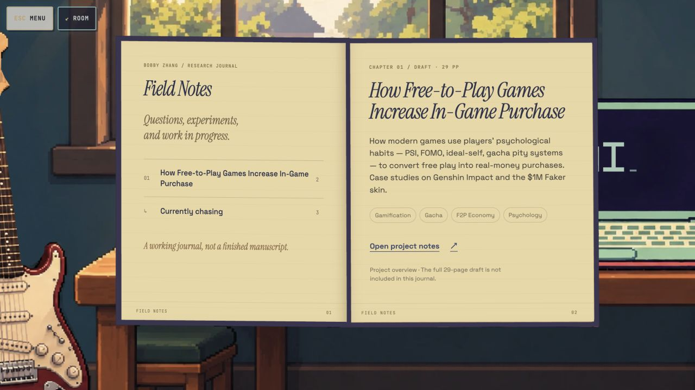
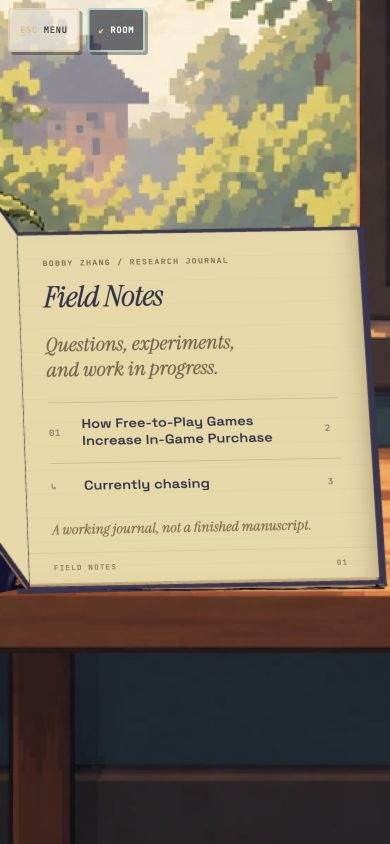
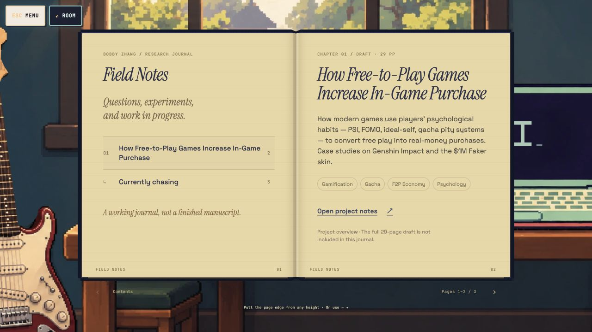

# Research book — Chat Check, November 2, 2026

Review the current Research book interaction, especially printed text during opening and closing, believable page manipulation, and unwanted native selection highlighting.

Repository: [My Personal Website](https://github.com/bobbyzhang133-star/My-Personal-Website). Branch: `codex/game-experiences-2026-10-13`. Runtime: **260ff82f01eb**. Baseline commit: `4e8dc666d2da22fecda10885b439dcadea20df5b`.

## Changes to assess

- Home and the Research transition use the same approved Blender-authored journal model, retaining the indigo cover, gilt details, yellow page edges and red markings. Shared Room and category transition dependencies are included in this snapshot.
- Current chapter text and scroll position are projected onto the actual moving reading surfaces throughout opening and closing. The opaque cover occludes the lettering. The old final blank-to-text dissolve is removed.
- Dragging follows a continuous vertical grab position. Recent release velocity allows short deliberate flicks; slow short pulls return. Native text selection is suppressed during accepted edge gestures and settling, while interior reading remains selectable.
- Moving text copies are inert and aria-hidden. Completion, cancellation and motion-preference changes remove temporary layers; accessible reading and navigation remain available.

## Evidence

These are portfolio-only screenshots and DOM samples from local release `46ea0745defa`; final release `260ff82f01eb` differs only by removal of two trailing blank lines and synchronized cache tokens. They are included here so a remote reviewer can access them. They do not establish motion quality by themselves.

[Browser samples and round-trip results](browser-check.json)

## Validation

- 85/85 rendered HTML and interaction/geometry regression tests pass (`node --test tests/rendered-html.test.mjs`).
- Scoped ESLint passes for changed runtime modules, authoring scripts and tests.
- Production build passes; its existing static route-classification notice remains.
- Content-derived release check passes: `260ff82f01eb`.
- Desktop 1280×720, portrait 390×844 and landscape 844×390 reviewed locally. Current chapter preservation, pause/resume, reduced motion and Research/detail/Room plus Games/Films/Music/AI round trips checked. Zero broken images, temporary layer leftovers or grounding failures in sampled completed routes.

## Limits and requested feedback

The moving words are native HTML projected onto mesh-derived planes, rather than glyph geometry inside the GLB. The page-turn curl remains a browser fold approximation, not cloth simulation or an arbitrary interior-point paper solver. No formal FPS benchmark, physical-device certification or cross-browser certification is claimed. Screenshots are static evidence; the remote reviewer cannot use Bobby's loopback preview.

Prioritize: late text appearance or popping; lettering/cover occlusion; differences between opening, closing and settled layouts; grab-height fidelity; flick versus cancel behavior; selection highlighting and accessibility regressions. Distinguish evidence-backed findings from motion hypotheses. Propose a focused next implementation prompt if improvements are needed; preserve the approved art direction, content, grounding, camera continuity and clean UI.

Local preview (available only on Bobby's computer): http://127.0.0.1:4174/ → Research. Direct /research/ starts in the reader. No public deployment is part of this Chat Check.
