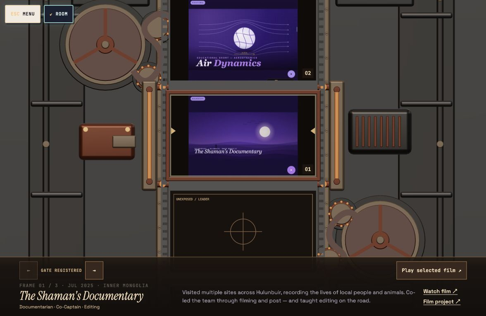
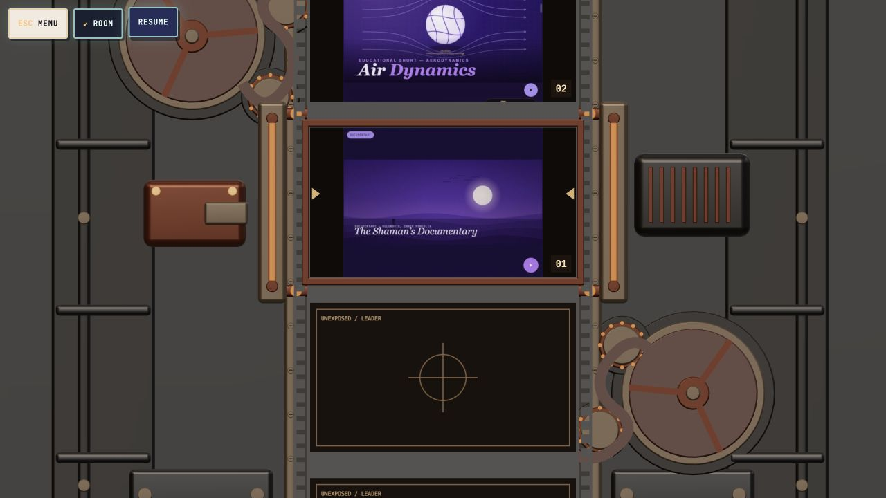
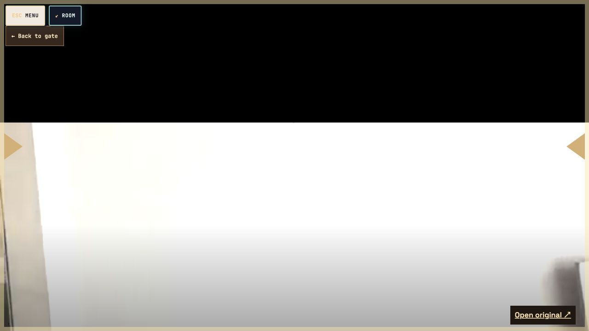
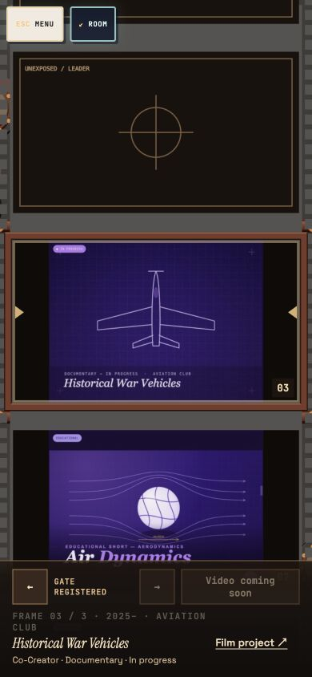
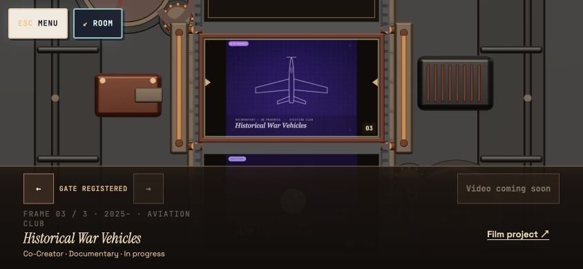

# Films exposure-side animation review

Local release: `8273376a5e68`. Preview: http://127.0.0.1:4174/films/ . This revision has not been deployed to the public website.

The real Studio 65 mesh remains active in Home, opening/return and Films. Blender MCP was reconnected and used to author four actual exposure pressure rails and export the refined v2 model. The approved base geometry and corner normals are preserved. The model has 80,624 triangles; its articulated cover, reels, stock and shutter remain real geometry. The mesh, GLB and metadata are under `assets/room/camera-live-v2/`.

## Review focus

The film strip is the project selector. Only the project registered in the exposure gate is selected. Advancing a project moves the strip and rotates the reels. Playing the gate frame starts six frames of projector drive, with a short spool-up before the continuous camera zoom into that same frame. The selected image stays registered during this projection sequence. The original video is requested lazily with autoplay after arrival. Returning unloads the player and restores the same selected frame. Drive state is retained for the outer camera return.

Eight noninteractive, explicitly unexposed leader frames fill both ends of the strip. Existing roughly 4:3 covers fit fully inside the 16:9 exposure with a dark matte and identical horizontal/vertical scale. Covers are not cropped, regenerated or stretched. The unfinished Historical War Vehicles project has no supplied video, so its gate action reads “Video coming soon” rather than entering an empty player.

Blender MCP is useful for the physical film path, reels, sprockets, pressure plate and gate clearance. Further geometry revisions should use the actual Blender model and export live mesh data, not replace this with rendered image sequences. Runtime camera movement, interaction, projection timing and accessibility remain browser responsibilities.

## Verification

- All 93 regression tests pass; scoped ESLint, production build, Python syntax, synchronized release and whitespace checks pass.
- Geometry coverage validates mesh buffers, normals, parts, full support base, retained reel diameter/centers and all four pressure rails. Projection matches the accessible HTML gate at desktop, portrait and short landscape.
- Cover-fitting tests retain source aspect ratios and complete bounds for 4:3, portrait and ultrawide art. Leader slots cannot become invented/selectable projects.
- Desktop 1280×720, portrait 390×844 and short landscape 844×390 inspected. Selected-project navigation, blank leader, missing-video state, playback and return inspected.
- Pause held projector drive at 1.103453793 for successive captures; Menu also holds motion. Resize and mid-animation reduced-motion switching settle safely and remove the temporary pause control. System motion and default viewport were restored afterward.
- Room return retains v2 WebGL geometry, zero missing images and no temporary projector/camera layers.
- Google Drive autoplay was requested and video imagery was visible in the embedded player. Autoplay/audio permissions remain browser/provider controlled; full-duration playback and physical-device performance are not claimed.

## Screenshots

